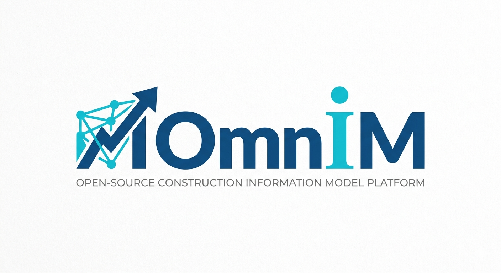

# OmniM - Engineering Unified Information Platform

[English](README.md) | [中文](README.zh-CN.md)

## Universal Engineering Project Lifecycle Platform for AEC, Plant, Civil, and Mechanical Domains

<p align="center">
  
</p>

<p align="center">
  <a href="LICENSE"></a>
  
</p>

OmniM is an **AI-Native Engineering Project Lifecycle Platform**. It unifies project data, 3D models, information models, documents, schedules, costs, assets, and operational data across Building Engineering, Civil Engineering, 3D Plant Design, and Mechanical Design. OmniM provides one continuous data foundation from planning, design, procurement, construction, commissioning, asset, operation & maintenance, production, to decommissioning.

At the core of OmniM are three layers:
- **Component Catalog (元件库)** — a master library of parametric 3D component definitions (inspired by PDMS PARAGON), each defined using the same sketch→constraint→feature pipeline
- **Series Library (系列库/等级库)** — project-approved component subsets with spec-driven selection trees (inspired by PDMS SPECON), enforcing engineering standards by constraining available component types, sizes, and materials
- **Omcom (OmniM Command)** — the unified modeling text DSL; all paths (command window, GUI, AI dialog) converge into Omcom instructions to operate the information model

---

## Table of Contents

- [Project Status](#project-status)
- [Core Vision](#core-vision)
- [Key Features](#key-features)
- [AMIR + Omcom](#amir--omcom)
- [Unified Data Model](#unified-data-model)
- [Multi-Domain Coverage](#multi-domain-coverage)
- [Lifecycle Support](#lifecycle-support)
- [Format Compatibility](#format-compatibility)
- [Documentation](#documentation)
- [Roadmap](#roadmap)
- [Contributing](#contributing)
- [License](#license)

---

## Project Status

&gt; **Current Stage: Phase 8 — Domain Extensions**
&gt;
&gt; OmniM is in active development. Phases 1–7 are complete (core data model & typed command executor, constraint solver & sketch system, feature engine & BRep kernel, component catalog & series library, catalog component modeling, GenRule refactoring & default templates, user interface). Phase 8 (domain extensions) is in progress. See [status/ROADMAP.md](docs/status/ROADMAP.md) and [status/CHANGELOG.md](docs/status/CHANGELOG.md).

---

## Core Vision

Traditional engineering software suffers from:
- **Domain Silos**: BIM, CAD, GIS, and Plant Design tools cannot natively communicate
- **Format Fragmentation**: IFC, STEP, DWG, RVT, and countless proprietary formats
- **AI Limitations**: LLMs hallucinate when working with precise engineering geometry
- **Project Lifecycle Gaps**: Planning, design, procurement, construction, commissioning, asset, operation & maintenance, production, and decommissioning data are disconnected

**OmniM solves this by:**
1. Providing an **IFC-superset unified data model** covering all engineering domains
2. Managing the **complete engineering project lifecycle** from planning to decommissioning
3. Adding **AMIR bidirectional instruction layer** for deterministic AI interaction
4. Enabling **natural language driven engineering and project management** through LLM ↔ AMIR compilation

---

## Key Features

### 🎯 Unified Data Model
- **IFC Superset**: Native compatibility with IFC 2x3, IFC 4, and 4x3
- **Multi-Domain Extensions**: Civil, Plant, and Mechanical domain extensions
- **Unified Classification**: Single object classification tree across all domains
- **Rich Relation System**: Containment, connection, spatial, and semantic relationships

### ☁️ Cloud-First Storage with Client Caching
- **Server-Authoritative**: All data stored on the server; single source of truth
- **Client Caching**: Ephemeral cache for 3D rendering and production-grade responsiveness
- **Viewport-Based Prefetch**: Only data in current view is cached and streamed
- **Real-Time Collaboration**: WebSocket-based change notifications for multi-user editing
- **Geometry Streaming**: Progressive LOD-aware download via HTTP Range

### 🖥️ Cross-Platform Client
- **Web**: Browser-based, zero install (WASM + WebGPU)
- **Desktop**: Native apps for Windows, macOS, and Linux (Tauri)
- **Mobile**: iOS and Android apps (React Native)
- **Shared Core**: All platforms share a common Rust/WASM core for AMIR, geometry, and domain logic

### 🎯 Omcom Text DSL Instruction System
- **Prompt → Omcom Text DSL**: Natural language compiles to deterministic Omcom text commands via AMIR
- **Omcom → Model**: Text DSL parsed and executed to create/modify geometry and data
- **Model → Omcom**: Reverse parsing converts existing models back to Omcom text sequences
- **Validator Sandbox**: All Omcom instructions validated before execution
- **Unified Entry**: Command window, GUI, and AI dialog all produce Omcom text DSL

### 📦 Component Catalog & Spec Library
- **Component Library (元件库)**: Master catalog of parametric 3D component definitions — beams (IPE/HEA/HEB), pipes (CS/SS), fittings (elbows, tees, flanges), valves, equipment, and building elements
- **Series Library (系列库/等级库)**: PDMS-style spec trees that select project-approved components with constrained size/material ranges
- **PARAGON-inspired**: Components defined using the same sketch→constraint→feature pipeline as project objects, with connection points (P-points) and type codes for compatibility matching
- **SPECON-inspired**: Decision tree selection engine (Question→Answer→Selector/SpecComponent) for pipe specs, structural series, and equipment libraries
- **Standards Enforcement**: Designers can only use components in the project's active series — prevents non-standard parts

### 📐 Parametric Modeling & Geometry
- **2D Constrained Sketch**: Lines, arcs, circles, splines on sketch planes with geometric constraints
- **Constraint Solver**: Hybrid graph-decomposition + numerical solver for 2D sketch constraints
- **Feature-Based 3D Modeling**: Extrude, Revolve, Sweep, Loft from constrained sketches
- **Construction History**: Feature tree with dependency regeneration and rollback
- **Parameter System**: Named parameters with expression-driven values
- **BRep Kernel**: Precise boundary representation with boolean operations, fillets, chamfers
- **Catalog-Driven Generation**: Project objects instantiated from catalog components, not hardcoded functions
- **Mesh Generation**: Parametric primitives (Box, Cylinder, Sphere, Cone), Layered extrusions, Linear components

### 🔄 Engineering Project Lifecycle Management
- **Planning**: Site selection, feasibility, zoning, requirements, project initiation
- **Design**: BIM/CAD models, drawings, specifications, calculations, design changes
- **Procurement**: Bill of materials, bidding, contracts, suppliers, delivery tracking
- **Construction**: Schedule, progress, quality, safety, RFIs, issues, as-built
- **Commissioning & Acceptance**: Testing, inspection, trial operation, acceptance, handover
- **Asset**: Asset registry, warranty, handover to owner, expected service life
- **Operation & Maintenance**: Operation, maintenance, work orders, facility management, energy
- **Production**: Industrial production operation (plant/manufacturing projects)
- **Decommissioning**: Retirement, demolition, disposal, site restoration

---

## AMIR + Omcom

AMIR is the AI-to-Omcom translation layer, and Omcom is the unified modeling **text DSL** format.

```
┌─────────────────┐     ┌─────────────────┐     ┌─────────────────┐     ┌──────────────┐     ┌─────────────────┐
│  Natural        │────▶│      AMIR       │────▶│   Omcom Text   │────▶│    Parser    │────▶│  Engineering    │
│  Language Prompt│     │  (AI Translator)│     │     DSL        │     │ (nom → Proto)│     │     Model       │
└─────────────────┘     └─────────────────┘     └─────────────────┘     └──────────────┘     └─────────────────┘
       ▲                        │                       │
       │                        ▼                       ▼
       │               (JSON Structured          (Engineers type
       │                 Intent Inside)           commands here)
       └─────────────────────────────────────────────────────────────┘
                          Bidirectional (AI ↔ Omcom DSL)
```

All paths (AI dialog, command window, GUI, OS CLI) ultimately converge into Omcom text DSL, parsed by a nom-based parser, and executed by a unified Executor.

[Read Omcom Specification →](docs/specification/OMCOM_SPEC.md)
[Read AMIR Specification →](docs/specification/AMIR_SPEC.md)

---

## Unified Data Model

OmniM's data model is designed as an IFC superset with extensions for all major engineering domains:

```
Object
├── SpatialElement
│   ├── Site
│   ├── Building
│   ├── BuildingStorey
│   └── Space
├── Element
│   ├── BuildingElement    (IFC compatible)
│   │   ├── Wall, Beam, Column, Slab, Door, Window...
│   ├── CivilElement       (Extension)
│   │   ├── Road, Bridge, Tunnel, Dam, Pipe...
│   ├── PlantElement       (Extension)
│   │   ├── Tank, Pump, Valve, HeatExchanger, Reactor...
│   └── MechanicalElement  (Extension)
│       ├── Part, Assembly, Fastener, Gear, Shaft...
└── System
    ├── BuildingSystem
    ├── CivilSystem
    ├── PlantSystem
    └── MechanicalSystem
```

[Read full Data Model Specification →](docs/specification/DATA_MODEL.md)

---

## Multi-Domain Coverage

| Domain | Status | Key Objects |
|--------|--------|-------------|
| 🏗️ **Building Engineering** | Core Design | Walls, beams, columns, slabs, doors, windows, stairs, roofs, MEP |
| 🛣️ **Civil Engineering** | Extension Design | Roads, bridges, tunnels, dams, culverts, retaining walls, utilities |
| 🏭 **3D Plant Design** | Extension Design | Tanks, pumps, valves, heat exchangers, reactors, pipes, structural steel |
| ⚙️ **Mechanical Design** | Extension Design | Parts, assemblies, fasteners, gears, shafts, bearings, motors |

[Read Domain Mapping Details →](docs/specification/DOMAINS.md)

---

## Lifecycle Support

| Phase | Data Coverage |
|-------|---------------|
| 📍 **Planning** | Site survey, topography, zoning, constraints, feasibility, requirements, project initiation |
| ✏️ **Design** | Architectural, structural, MEP, civil, plant, and mechanical models, drawings, calculations |
| 📦 **Procurement** | Bill of materials, bidding, contracts, suppliers, cost estimates, delivery tracking |
| 🏗️ **Construction** | Schedule, progress, quality inspections, safety, RFIs, issues, as-built conditions |
| ✅ **Commissioning & Acceptance** | Equipment commissioning, testing, inspection, trial operation, acceptance, handover |
| 🏷️ **Asset** | Asset registry, warranty setup, handover to owner, expected service life, spare parts |
| 🔧 **Operation & Maintenance** | Operation, maintenance, work orders, facility management, energy, space utilization |
| 🏭 **Production** | Production plans, batches, throughput, yield, downtime, OEE (plant/manufacturing) |
| ♻️ **Decommissioning** | Retirement, dismantling, demolition, hazardous material disposal, site restoration |

[Read Lifecycle Data Model →](docs/specification/LIFECYCLE.md)

---

## Format Compatibility

| Format | Import | Export | Notes |
|--------|--------|--------|-------|
| IFC 2x3/4x3 | ✅ Planned | ✅ Planned | Primary BIM format |
| STEP AP203/AP242 | ✅ Planned | ✅ Planned | Mechanical CAD format |
| GIS (Shapefile, GeoJSON) | ✅ Planned | ✅ Planned | Geospatial data |
| DWG/DXF | ✅ Planned | ✅ Planned | 2D CAD drawings |
| glTF/GLB | ✅ Planned | ✅ Planned | Web 3D visualization |
| OBJ/FBX | ✅ Planned | ✅ Planned | General 3D formats |
| RVT (Revit) | 📋 Research | ❌ | Requires Autodesk license |

[Read Format Compatibility Matrix →](docs/status/FORMAT_COMPAT.md)

---

## Documentation

- [Documentation Portal](docs/README.md) - Full documentation index by role ([中文](docs/README.zh-CN.md))
- [Platform Architecture](docs/architecture/PLATFORM_ARCH.md) - Current implementation ([中文](docs/architecture/PLATFORM_ARCH.zh-CN.md))
- [Data Flow](docs/architecture/DATA_FLOW.md) - End-to-end flows ([中文](docs/architecture/DATA_FLOW.zh-CN.md))
- [Decision Records](docs/architecture/DECISIONS.md) - Architecture decision log ([中文](docs/architecture/DECISIONS.zh-CN.md))
- [Data Model](docs/specification/DATA_MODEL.md) - Unified engineering data model ([中文](docs/specification/DATA_MODEL.zh-CN.md))
- [Omcom Specification](docs/specification/OMCOM_SPEC.md) - Unified typed command system ([中文](docs/specification/OMCOM_SPEC.zh-CN.md))
- [AMIR Specification](docs/specification/AMIR_SPEC.md) - AI intermediate representation ([中文](docs/specification/AMIR_SPEC.zh-CN.md))
- [Catalog & Series Library](docs/specification/CATALOG_SERIES.md) - 元件库/系列库 spec ([中文](docs/specification/CATALOG_SERIES.zh-CN.md))
- [IFC Extension Strategy](docs/specification/IFC_EXTENSION.md) - IFC compatibility and extensions ([中文](docs/specification/IFC_EXTENSION.zh-CN.md))
- [Format Compatibility](docs/status/FORMAT_COMPAT.md) - Honest multi-format support matrix ([中文](docs/status/FORMAT_COMPAT.zh-CN.md))
- [Lifecycle Model](docs/specification/LIFECYCLE.md) - Project lifecycle data mapping ([中文](docs/specification/LIFECYCLE.zh-CN.md))
- [Domains](docs/specification/DOMAINS.md) - Multi-domain object mapping ([中文](docs/specification/DOMAINS.zh-CN.md))
- [REST API Reference](docs/reference/API.md) - All server endpoints ([中文](docs/reference/API.zh-CN.md))
- [Omcom Command Reference](docs/reference/OMCOM_REFERENCE.md) ([中文](docs/reference/OMCOM_REFERENCE.zh-CN.md))
- [Storage Model](docs/RFC/STORAGE_MODEL.md) - Cloud-first storage design proposal (not yet implemented) ([中文](docs/RFC/STORAGE_MODEL.zh-CN.md))
- [Glossary](docs/reference/GLOSSARY.md) - Terminology reference ([中文](docs/reference/GLOSSARY.zh-CN.md))
- [Getting Started](docs/guides/GETTING_STARTED.md) - Run it in five minutes ([中文](docs/guides/GETTING_STARTED.zh-CN.md))
- [Roadmap](docs/status/ROADMAP.md) - Development roadmap and phases ([中文](docs/status/ROADMAP.zh-CN.md))
- [Changelog](docs/status/CHANGELOG.md) ([中文](docs/status/CHANGELOG.zh-CN.md))
- [Code Deviations](docs/status/CODE_DEVIATIONS.md) - Spec-vs-code gap ledger ([中文](docs/status/CODE_DEVIATIONS.zh-CN.md))
- [RFC](docs/RFC/README.md) - Open design discussions ([中文](docs/RFC/README.zh-CN.md))

---

## Roadmap

See the detailed [Roadmap document](docs/status/ROADMAP.md) for the complete phased development plan.

### Current Status

- **Phase 1**: Core Data Model & Omcom DSL — ✅ Complete
- **Phase 2**: Constraint Solver & Sketch System — ✅ Complete
- **Phase 3**: Feature Engine & BRep Kernel — ✅ Complete
- **Phase 4**: Component Catalog & Series Library — ✅ Complete
- **Phase 5**: Catalog Component Modeling — ✅ Complete
- **Phase 6**: GenRule Refactoring & Default Templates — ✅ Complete
- **Phase 7**: User Interface — ✅ Complete
- **Phase 8**: Domain Extensions — 🔄 In Progress
- **Phase 9**: AMIR AI Compilation — 📅 Planned
- **Phase 10**: Multi-User / Cloud — 📅 Planned
- **Phase 11**: IFC/STEP Format Compatibility — 📅 Planned

[Read full Roadmap →](docs/status/ROADMAP.md)

---

## Contributing

We welcome all forms of contribution:
- Discussion and refinement of the data model
- AMIR specification improvements
- Submitting issues for bugs or suggestions
- Code contributions to the prototype

Guidelines will be added in CONTRIBUTING.md. For now, please open an issue or discussion.

### Code of Conduct

This project will adopt the Contributor Covenant Code of Conduct.

---

## License

Copyright (c) 2026 OmniM Contributors

This project is open source under the **GNU Affero General Public License v3.0 (AGPL-3.0)**. See the [LICENSE](LICENSE) file for the full agreement.

AGPL-3.0 requires: If you modify this software and provide it over a network, you must make the modified complete source code available to users.
