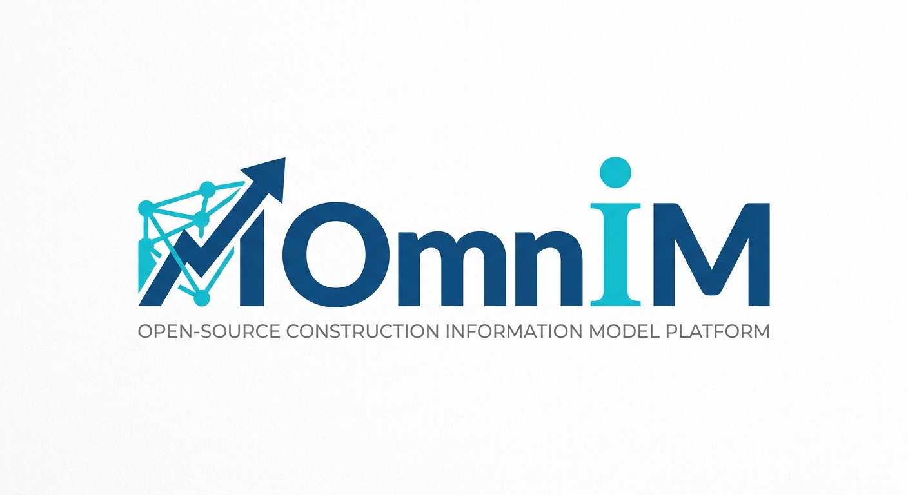

# OmniM - 工程统一信息平台

[English](README.md) | [中文](README.zh-CN.md)

## 面向建筑、土木、工厂、机械的工程项目全生命周期平台

<p align="center">
  
</p>

<p align="center">
  <a href="LICENSE"></a>
  
</p>

OmniM 是一个 **AI 原生的工程项目全生命周期平台**。它统一建筑工程、土木工程、工厂设计、机械设计中的项目数据、三维模型、信息模型、文档、进度、成本、资产和运营数据，为从规划、设计、采购、施工、调试验收、资产、运维、生产到退役拆除的全过程提供连续的数据底座。

> **愿景 vs 现状。** 本 README 描述产品愿景。代码今天实际能做什么，请看[路线图](docs/status/ROADMAP.zh-CN.md)、[格式兼容性矩阵](docs/status/FORMAT_COMPAT.zh-CN.md)、[代码偏差台账](docs/status/CODE_DEVIATIONS.zh-CN.md)与[写入路径快照](docs/architecture/WRITE_PATHS.zh-CN.md)。标有 🗓 Planned 的能力是设计目标，**尚未实现**。

OmniM 的核心由三层构成：
- **元件库 (Component Catalog)** —— 参数化三维构件的母库（源自 PDMS PARAGON），所有构件使用相同的草图→约束→特征管线定义
- **系列库/等级库 (Series Library)** —— 项目批准的构件子集，带选择器决策树（源自 PDMS SPECON），通过约束类型、尺寸和材质来强制工程规范
- **Omcom (OmniM Command)** —— 类型化命令层（`OmniCommand` + Validator/Executor）与 Web 控制台；自由文本 DSL 为 🗓 Planned。目标：命令窗口、图形界面、AI 对话框最终都汇聚到同一条命令管线。

---

## 目录

- [项目状态](#项目状态)
- [核心愿景](#核心愿景)
- [核心特性](#核心特性)
- [AMIR: AI 中间表示层](#amir-ai-中间表示层)
- [统一数据模型](#统一数据模型)
- [多领域覆盖](#多领域覆盖)
- [全生命周期支持](#全生命周期支持)
- [格式兼容性](#格式兼容性)
- [文档](#文档)
- [路线图](#路线图)
- [贡献](#贡献)
- [许可证](#许可证)

---

## 项目状态

&gt; **当前阶段：第八阶段 — 领域扩展**
&gt;
&gt; OmniM 正在活跃开发中。第 1–7 阶段已交付，其中**第一阶段为部分完成**（类型化 `OmniCommand` schema 与执行器已存在；基于 nom 的 Omcom 文本 DSL 不存在）。第 8 阶段（领域扩展）进行中；第 9 阶段（AMIR）已提前部分交付。参见[路线图](docs/status/ROADMAP.zh-CN.md)与[变更日志](docs/status/CHANGELOG.zh-CN.md)。服务器当前提供 **79** 条去重 REST 路由；**无 WebSocket、无数据库**。变更默认落盘到 `project.omnim`（或 `$OMNIM_PROJECT`）；设置 `OMNIM_EPHEMERAL=1` 可完全内存运行。撤销/重做覆盖全部变更端点（[WRITE_PATHS.zh-CN.md](docs/architecture/WRITE_PATHS.zh-CN.md)）。

---

## 核心愿景

传统工程软件面临的问题：
- **领域孤岛**：BIM、CAD、GIS、工厂设计工具无法原生互通
- **格式碎片化**：IFC、STEP、DWG、RVT 以及无数专有格式
- **AI 局限性**：大模型处理精确工程几何时容易产生幻觉
- **工程项目生命周期断层**：规划、设计、采购、施工、调试验收、资产、运维、生产和退役拆除数据彼此割裂

**OmniM 的解决方案：**
1. 提供 **IFC 超集的统一数据模型**，覆盖所有工程领域
2. 管理从规划到退役拆除的**工程项目完整生命周期**
3. 增加 **AMIR 双向指令层**，实现确定性 AI 交互
4. 通过 LLM ↔ AMIR 编译，实现**自然语言驱动的工程建模与项目管理**

---

## 核心特性

### 🎯 统一数据模型
- **与 IFC 对齐的模型**：当前支持部分 IFC 2x3 / IFC 4 导入导出；IFC 4x3 特有实体为 🗓 Planned。见 [FORMAT_COMPAT](docs/status/FORMAT_COMPAT.zh-CN.md)。
- **多领域扩展**：土木、工厂、机械领域扩展
- **统一分类**：跨领域的单一对象分类树
- **丰富关系系统**：包含、连接、空间、语义关系

### 🎯 类型化 OmniCommand + Omcom 控制台
- **Prompt → OmniCommand**：自然语言经由 AMIR 编译为结构化、可校验的命令
- **Omcom 控制台**：执行 JSON `OmniCommand`、快捷命令 `CREATE_OBJECT <type> <name>`，或 `UNDO`/`REDO`
- **Omcom 文本 DSL**：🗓 Planned —— 草案 [RFC-0001](docs/RFC/README.zh-CN.md)；nom 解析器尚不存在
- **验证沙箱**：executor 路径的命令在执行前经过校验（并非每条 REST 路由；见 [WRITE_PATHS](docs/architecture/WRITE_PATHS.zh-CN.md)）
- **统一入口**：目标架构（ADR-0006）；单一写入路径目前只部分实现

### 📦 元件库 & 系列库/等级库
- **元件库**：参数化三维构件的母库——钢梁（IPE/HEA/HEB）、管道（CS/SS）、管件（弯头、三通、法兰）、阀门、设备、建筑构件
- **系列库/等级库**：PDMS-style 决策树，从目录中筛选项目批准的构件，约束尺寸/材质范围
- **PARAGON 式定义**：构件使用与项目对象相同的草图→约束→特征管线建模，带连接点（P-point）和类型码
- **SPECON 式选择**：问题→答案→选择器/构件的决策树引擎，用于管道等级、结构系列、设备库
- **规范强制**：🔀 部分实现——当前门禁只检查构件可达性；材质/参数/连接校验尚未强制（见 [CODE_DEVIATIONS §6](docs/status/CODE_DEVIATIONS.zh-CN.md#6-写入路径持久化与几何路径偏差--known2026-10-27)）

### 📐 参数化建模与几何
- **2D 约束草图**：在草图平面上的直线、圆弧、圆、样条曲线，支持几何约束
- **约束求解器**：混合图分解 + 数值求解的 2D 草图约束求解
- **基于特征的 3D 建模**：从约束草图拉伸、旋转、扫掠、放样
- **构建历史**：特征树，支持依赖重算和回滚
- **参数系统**：命名参数与表达式驱动的值
- **BRep 内核**：精确边界表示，支持布尔运算、圆角、倒角
- **特征树生成**：官方几何路径是目录特征树 → BRep/网格。工具栏 `/api/genrule` 生成硬编码图元的直通路径属于**遗留/过渡**方案。
- **网格生成**：参数化图元（Box、Cylinder、Sphere、Cone）、层拉伸、线构件

### 🔄 工程项目全生命周期管理
- **规划**：立项、选址、用地、分区、可行性、项目需求
- **设计**：BIM/CAD 模型、图纸、规格书、计算书、设计变更
- **采购**：招标、物料清单、合同、供应商、成本、交付跟踪
- **施工**：进度、质量、安全、RFI、问题、竣工记录
- **调试验收**：设备调试、测试、试运行、检查、验收、移交
- **资产**：资产登记、质保、移交业主、预期寿命、备件
- **运维**：运行、维护、工单、设施管理、能耗、空间利用
- **生产**：生产计划、批次、产量、停机、OEE（工厂/制造项目）
- **退役拆除**：退役、拆除、危废处置、场地恢复、结项

### ☁️ 云端存储与客户端缓存 — 🗓 Planned
> 尚未实现。现状：单个内存 `Project` + 可选单 JSON 文件（`.omnim`），无数据库。
- **服务端权威**：所有数据存储在服务器，客户端不持久化数据
- **客户端缓存**：为 3D 渲染性能和响应式交互提供临时缓存
- **几何流式传输**：通过 HTTP Range 渐进式下载大型几何数据
- **实时同步**：基于 WebSocket 的缓存失效与协同更新
- **乐观 UI**：即时本地反馈，服务端确认

### 🖥️ 跨平台客户端
- **Web 浏览器**：✅ 现状——浏览器 SPA（React + three.js）。WASM/WebGPU 浏览器内引擎为 🗓 Planned。
- **桌面端**：🗓 Planned——Windows、macOS、Linux (Tauri)
- **移动端**：🗓 Planned——iOS、Android (React Native)
- **共享内核**：🗓 Planned——当前不存在 Rust 引擎的 WASM 构建；领域逻辑由服务器持有。
- **性能**：不承诺全平台 60 FPS；渲染性能取决于客户端与场景。

---

## AMIR + Omcom

AMIR 是 AI 与命令之间的翻译层。**Omcom** 目前是类型化 `OmniCommand` 系统加一个 Web 控制台；自由文本 **DSL** 为 🗓 Planned（[RFC-0001](docs/RFC/README.zh-CN.md)）。

```
┌─────────────────┐     ┌─────────────────┐     ┌─────────────────┐     ┌──────────────┐     ┌─────────────────┐
│   自然语言提示词  │────▶│      AMIR       │────▶│  OmniCommand   │────▶│ Validator /  │────▶│    工程模型      │
│    Prompt       │     │  AI 翻译层       │     │  类型化 JSON    │     │   Executor   │     │     Model       │
└─────────────────┘     └─────────────────┘     └─────────────────┘     └──────────────┘     └─────────────────┘
```

AMIR 生成的命令进入 Validator/Executor。**目标**：所有路径（AI 对话框、命令控制台、图形界面、OS CLI）都汇聚到同一条命令管线（ADR-0006）。**现状**：只部分成立——许多 REST handler 直接写 `Project`（见 [WRITE_PATHS](docs/architecture/WRITE_PATHS.zh-CN.md)）。

[查看 Omcom 规范 →](docs/specification/OMCOM_SPEC.zh-CN.md)
[查看 AMIR 规范 →](docs/specification/AMIR_SPEC.zh-CN.md)

---

## 统一数据模型

OmniM 的数据模型设计为 IFC 超集，支持所有主要工程领域的扩展：

```
Object
├── SpatialElement（空间元素）
│   ├── Site（场地）
│   ├── Building（建筑）
│   ├── BuildingStorey（楼层）
│   └── Space（空间）
├── Element（构件元素）
│   ├── BuildingElement    （建筑元素 - IFC 兼容）
│   │   ├── Wall（墙）, Beam（梁）, Column（柱）, Slab（板）, Door（门）, Window（窗）...
│   ├── CivilElement       （土木工程元素 - 扩展）
│   │   ├── Road（道路）, Bridge（桥梁）, Tunnel（隧道）, Dam（大坝）, Pipe（管道）...
│   ├── PlantElement       （工厂元素 - 扩展）
│   │   ├── Tank（储罐）, Pump（泵）, Valve（阀门）, HeatExchanger（换热器）, Reactor（反应器）...
│   └── MechanicalElement  （机械元素 - 扩展）
│       ├── Part（零件）, Assembly（装配）, Fastener（紧固件）, Gear（齿轮）, Shaft（轴）...
└── System（系统）
    ├── BuildingSystem（建筑系统）
    ├── CivilSystem（土木系统）
    ├── PlantSystem（工厂系统）
    └── MechanicalSystem（机械系统）
```

[查看完整数据模型规范 →](docs/specification/DATA_MODEL.zh-CN.md)

---

## 多领域覆盖

| 领域 | 状态 | 核心对象 |
|------|------|---------|
| 🏗️ **建筑工程** | 核心设计 | 墙、梁、柱、板、门、窗、楼梯、屋顶、机电 |
| 🛣️ **土木工程** | 扩展设计 | 道路、桥梁、隧道、大坝、涵洞、挡土墙、公用设施 |
| 🏭 **工厂设计** | 扩展设计 | 储罐、泵、阀门、换热器、反应器、管道、钢结构 |
| ⚙️ **机械设计** | 扩展设计 | 零件、装配、紧固件、齿轮、轴、轴承、电机 |

[查看领域映射详情 →](docs/specification/DOMAINS.zh-CN.md)

---

## 全生命周期支持

| 阶段 | 数据覆盖 |
|------|---------|
| 📍 **规划** | 项目立项、可行性、选址、用地、分区、约束、项目需求 |
| ✏️ **设计** | 建筑、结构、机电、土木、工厂、机械模型、图纸、计算书 |
| 📦 **采购** | 物料清单、招投标、合同、供应商、成本估算、交付跟踪 |
| 🏗️ **施工** | 进度、进展、质量检查、安全、RFI、问题、竣工记录 |
| ✅ **调试验收** | 设备调试、测试、检查、试运行、验收、移交 |
| 🏷️ **资产** | 资产登记、质保、移交业主、预期使用寿命、备件 |
| 🔧 **运维** | 运行、维护、工单、设施管理、能耗、空间利用 |
| 🏭 **生产** | 生产计划、批次、产量、停机时间、OEE（工厂/制造项目） |
| ♻️ **退役拆除** | 报废、退役、拆除、危废处置、场地恢复、竣工关闭 |

[查看生命周期数据模型 →](docs/specification/LIFECYCLE.zh-CN.md)

---

## 格式兼容性

| 格式 | 导入 | 导出 | 说明 |
|------|------|------|------|
| IFC 2x3/4 | ✅ 部分支持 | ✅ 部分支持 | 手写解析器；实体覆盖不完整 |
| IFC 4x3 | 🗓 计划中 | 🗓 计划中 | 尚无 4x3 特有实体 |
| STEP AP203/AP242 | ✅ 计划中 | ✅ 计划中 | 机械 CAD 格式 |
| GIS (Shapefile, GeoJSON) | ✅ 计划中 | ✅ 计划中 | 地理空间数据 |
| DWG/DXF | ✅ 计划中 | ✅ 计划中 | 2D CAD 图纸 |
| glTF/GLB | ✅ 计划中 | ✅ 计划中 | Web 3D 可视化 |
| OBJ/FBX | ✅ 计划中 | ✅ 计划中 | 通用 3D 格式 |
| RVT (Revit) | 📋 研究中 | ❌ | 需要 Autodesk 许可 |

[查看格式兼容性矩阵 →](docs/status/FORMAT_COMPAT.zh-CN.md)

---

## 文档

> 📖 核心文档提供英文与中文两个版本；`docs/research/` 下的研究文档目前仅英文。点击下方链接查看中文版。

- [文档门户](docs/README.zh-CN.md) - 按角色索引的全部文档
- [平台架构](docs/architecture/PLATFORM_ARCH.zh-CN.md) - 当前实现的分层架构
- [前端 PRD 与界面契约](docs/product/PRD_FRONTEND.zh-CN.md) - 96 条前端需求、外壳、设计系统、交互、数据完整性（[English](docs/product/PRD_FRONTEND.md)）
- [前端成熟度](docs/status/FRONTEND_MATURITY.zh-CN.md) - ISO/IEC 25010 评分与距商用的诚实距离（[English](docs/status/FRONTEND_MATURITY.md)）
- [数据流](docs/architecture/DATA_FLOW.zh-CN.md) - 端到端数据流
- [写入路径](docs/architecture/WRITE_PATHS.zh-CN.md) - 逐端点保存/撤销状态快照
- [架构决策记录](docs/architecture/DECISIONS.zh-CN.md) - 关键技术决策记录
- [数据模型](docs/specification/DATA_MODEL.zh-CN.md) - 统一工程数据模型
- [Omcom 规范](docs/specification/OMCOM_SPEC.zh-CN.md) - 统一类型化命令系统
- [AMIR 规范](docs/specification/AMIR_SPEC.zh-CN.md) - AI 中间表示层规范
- [元件库与系列库](docs/specification/CATALOG_SERIES.zh-CN.md) - 元件库/系列库规范
- [IFC 扩展策略](docs/specification/IFC_EXTENSION.zh-CN.md) - IFC 兼容性与扩展
- [格式兼容性](docs/status/FORMAT_COMPAT.zh-CN.md) - 如实的多格式支持矩阵
- [生命周期模型](docs/specification/LIFECYCLE.zh-CN.md) - 项目生命周期数据映射
- [领域覆盖](docs/specification/DOMAINS.zh-CN.md) - 四大工程领域对象映射
- [REST API 参考](docs/reference/API.zh-CN.md) - 全部服务端端点
- [Omcom 命令参考](docs/reference/OMCOM_REFERENCE.zh-CN.md)
- [存储模型](docs/RFC/STORAGE_MODEL.zh-CN.md) - 云优先存储设计提案（尚未实现）
- [术语表](docs/reference/GLOSSARY.zh-CN.md) - 术语参考
- [快速开始](docs/guides/GETTING_STARTED.zh-CN.md) - 五分钟跑起来
- [路线图](docs/status/ROADMAP.zh-CN.md) - 开发路线图与阶段
- [变更日志](docs/status/CHANGELOG.zh-CN.md)
- [代码偏差记录](docs/status/CODE_DEVIATIONS.zh-CN.md) - 规范与实现差异台账
- [RFC](docs/RFC/README.zh-CN.md) - 开放设计讨论

---

## 路线图

完整的分阶段计划见[路线图文档](docs/status/ROADMAP.zh-CN.md)。

### 当前状态

- **第 1 阶段**：核心数据模型 & Omcom DSL — 🔀 部分完成（类型化命令 + 执行器；文本 DSL 未实现）
- **第 2 阶段**：约束求解器 & 草图系统 — ✅ 完成
- **第 3 阶段**：特征引擎 & BRep 内核 — ✅ 完成
- **第 4 阶段**：元件库 & 系列库 — ✅ 完成
- **第 5 阶段**：目录元件建模 — ✅ 完成
- **第 6 阶段**：GenRule 重构与默认模板 — ✅ 完成
- **第 7 阶段**：用户界面 — ✅ 完成（有一项已知缺口）
- **第 8 阶段**：领域扩展 — 🔄 进行中
- **第 9 阶段**：AMIR AI 编译 — 🔄 部分完成（提前交付，仍有缺口）
- **第 10 阶段**：多用户 / 云端 — 📅 计划中
- **第 11 阶段**：IFC/STEP 格式兼容 — 🔀 部分完成
- **第 12 阶段**：分析与生态 — 📅 计划中

[查看完整路线图 →](docs/status/ROADMAP.zh-CN.md)

---

## 贡献

我们欢迎所有形式的贡献：
- 讨论和完善数据模型
- AMIR 规范改进
- 提交 Bug 或建议
- 为原型贡献代码

指南将在 CONTRIBUTING.md 中添加。目前请通过 Issue 或讨论参与。

### 行为准则

本项目将采用 Contributor Covenant 行为准则。

---

## 许可证

版权所有 (c) 2026 OmniM 贡献者

本项目基于 **GNU Affero General Public License v3.0 (AGPL-3.0)** 开源。完整协议见 [LICENSE](LICENSE) 文件。

AGPL-3.0 要求：如果您修改本软件并通过网络提供服务，您必须向用户提供修改后的完整源代码。
