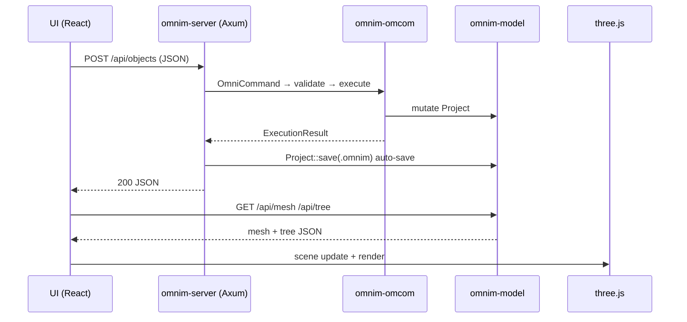
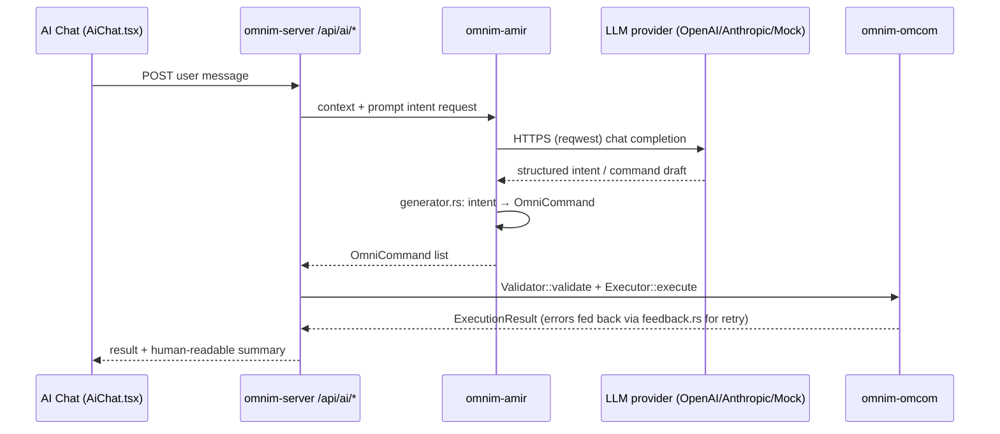
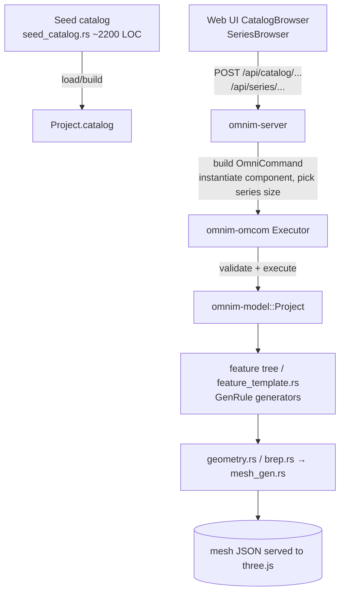
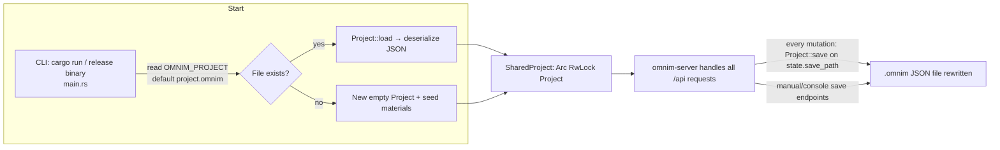

# OmniM — Data Flows

This document describes the **end-to-end data flows that actually exist in the code today**, based on
`crates/server/src/lib.rs`, `crates/omcom/src/lib.rs`, `crates/amir/src/generator.rs`, and `crates/ifc/`.
Where a mechanism is only planned, it is explicitly labeled **planned**.

The architectural overview lives in [PLATFORM_ARCH.md](PLATFORM_ARCH.md); this page zooms in on *how data moves*.

---

## 0. The Universal Mutation Rule

Before the specific flows: **every write to the `Project` — whether triggered by a mouse click, an AI answer, or a REST
call — becomes an `OmniCommand`** (schema in `proto/omcom.proto`, types in `omnim-omcom`) and then flows through:

```
OmniCommand ──▶ Validator::validate(cmd, &Project)──▶ (gather errors; abort if any)
            ──▶ Executor::execute(cmd, &mut Project) ─▶ ExecutionResult + undo/redo entry
```

This single choke point is the backbone of every diagram below.

---

## 1. (a) User click → REST → Executor → model mutation → mesh → three.js render

The bread-and-butter flow, e.g. "create a wall" clicked in the toolbar:

```
┌─ Browser ──────────────────────────────────────────────────────┐
│ React component (e.g. MainToolbar.tsx)                          │
│   │ user click                                                  │
│   ▼                                                             │
│ typed REST client (shared/api.ts) → POST /api/objects  (JSON)   │
│   … Zustand store / React Query invalidates affected queries     │
└──────────────────────────────┬──────────────────────────────────┘
                               │ HTTP /api/*
┌──────────────────────────────▼──────────────────────────────────┐
│ omnim-server (Axum)                                             │
│   • route handler acquires project.write() + executor.write()   │
│   • assembles OmniCommand{ action, operations:[…] }             │
│   • Executor::execute() → validates → mutates Project           │
│   • Project::save(save_path) — auto-save the .omnim JSON file   │
│   • returns object/JSON (or error status)                       │
└──────────────────────────────┬──────────────────────────────────┘
                               │ 200 OK
       (browser again)         │
                               ▼
      React Query refetches the object tree → mesh fetch
                               │
┌──────────────────────────────▼──────────────────────────────────┐
│ omnim-model                                                      │
│   geometry.rs / brep.rs build solids (truck kernel)              │
│   mesh_gen.rs tessellates → triangle mesh (positions/normals)    │
└──────────────────────────────┬──────────────────────────────────┘
                               │
┌──────────────────────────────▼──────────────────────────────────┐
│ three.js renderer (web/src/app/components/ThreeViewer.tsx)       │
│   loads mesh + object transform, updates scene graph, renders    │
└─────────────────────────────────────────────────────────────────┘
```

Notes grounded in code:

- The **mesh is fetched repeatedly from the server** — geometry regeneration happens Rust-side in
  `omnim-model` (mesh_gen.rs), and the browser is a pure display client.
- There is **no push channel**: after each mutation the UI re-pulls state (queries invalidated after the
  call resolves). No WebSocket exists in the codebase.

### Mermaid version



---

## 2. (b) Natural language → AMIR engine → OmniCommand → Validator → Executor



What happens in code:

1. **Context assembly** (`amir::context`): a snapshot of the relevant `Project` state (selected objects, catalog info,
   recent history) is built so the LLM can ground its answer.
2. **Provider abstraction** (`amir::lib`): provider is selected by configuration value `"openai" | "anthropic"`, with a
   `Mock` provider for offline/testing. Communication is **plain HTTPS** via `reqwest` — no SDK, no local model runtime.
3. **Intent → command** (`amir::generator.ts`): a large rule + template file maps intents onto concrete `OmniCommand`
   payloads; `prompt_parser.rs` handles looser free-form input, `templates.rs` holds response templates, and
   `feedback.rs` turns Executor errors back into retryable AI feedback.
4. **Same gate:** the generated commands are **not** applied directly to the `Project`; they enter the same
   Validator/Executor as user clicks (see §0). This is the key safety property — a hallucinated command fails loudly
   instead of corrupting state.
5. **Reverse direction** (`amir::reverse`): the engine can also describe an existing `Project` in natural language
   (documentation/summarization, not mutation).

---

## 3. (c) IFC import / export

```mermaid
sequenceDiagram
    U as Web UI (Library manager / import actions)
    S as omnim-server /api/ifc/*
    I as omnim-ifc (hand-written STEP parser)
    M as omnim-model
    Note over I,M: EXPORT path
    U->>S: request export
    S->>M: read current Project
    M-->>S: objects/geometry
    S->>I: serialize Project → STEP text
    I-->>S: IFC 2x3 / IFC 4 subset text
    S-->>U: file download

    Note over I,M: IMPORT path
    U->>S: upload .ifc file
    S->>I: parse text (hand-written, no IFC crate)
    I-->>S: parsed IFC records + mapped geometry (geometry.rs)
    S->>M: build OmniCommand(s) creating objects
    M-->>S: mutated Project (goes through Validator+Executor, then auto-save)
    S-->>U: imported objects
```

Facts from the code:

- `omnim-ifc` contains a **hand-written parser and serializer** (no `ifc`-ecosystem Rust crate is used — ADR-0005).
- Coverage is **partial** — a subset of **IFC 2x3 and IFC 4** entities/attributes; unsupported entities are skipped
  rather than rejected wholesale.
- Imports do **not** native-write into the `Project`; they are converted into `OmniCommand`s (or into model-building
  calls invoked through the same command path) so imported content lands on the undo stack like any other mutation.
- Sample IFC files under `fixtures/ifc/` (`simple.ifc`, `test_building.ifc`, `part.ifc`, …) exercise this flow.

---

## 4. (d) Catalog / series instantiation

The PARAGON-style **component catalog** and SPECON-style **series library** live in `omnim-model`
(`catalog.rs`, `seed_catalog.rs`, `series_store.rs`, `library.rs`).



Narrative:

1. **Catalog entry:** each catalog component declares a parameter schema and default parameters (PARAGON-style
   parameter-driven part definition).
2. **Series:** a series binds one catalog component to a family of dimensioned variants (SPECON-style), so a user picks
   a **series + size** rather than raw dimensions.
3. **Instantiation:** choosing one produces an *instantiate* `OmniCommand`; execution adds an object to the project tree,
   parameters filled from the chosen series' record.
4. **Generation:** the new object's feature tree (`GenRule` generator, `feature_template.rs`) drives geometry building
   (`brep.rs` via the truck kernel) and tessellation (`mesh_gen.rs`), which is then served to the three.js viewer.

Everything downstream of the catalog pick therefore looks like flow §1; only the *start* differs.

---

## 5. (e) Save / load of `.omnim` JSON files



Mechanics:

- **One file per process.** `omnim-server::ServerConfig { project, save_path, halt }`. `save_path` is `Some` when
  `OMNIM_PROJECT` points to a writable path, `None` when the default placeholder is used (then nothing is auto-saved).
- **Full-rewrite, not incremental.** Each save serializes the **entire `Project`** to JSON and rewrites the file.
  There is no journal, no WAL, no checkpointing.
- **Crash window:** a kill between mutation and successful write can leave the file stale or (theoretically) truncated;
  there is no atomic-rename pattern yet.
- **No history.** One file = one snapshot. Undo/redo lives only in in-memory `Executor` state.
- **Size risk:** for very large projects (big `seed_catalog` expansions), full serialization of a monolithic file is
  inherently O(project size) per mutation. This is the concrete motivation behind the planned database-backed
  persistence (see [PLATFORM_ARCH.md §9](PLATFORM_ARCH.md#sec-future)).

---

## 6. Non-flows (things that do **not** exist)

For clarity, the following paths that people sometimes assume are **not implemented**:

- **No WebSocket / SSE / push.** The browser polls with React Query re-fetches.
- **No streaming LLM output.** AMIR's LLM responses are consumed whole, then command-validated.
- **No server-side rendering of previews** — neither rasterized images nor server-gl timers.
- **No multi-file-project model**, no per-object file persistence. There is one `.omnim`.
- **No worktree/branching** in version-model sense (repository `git` branches are unrelated to the product).
