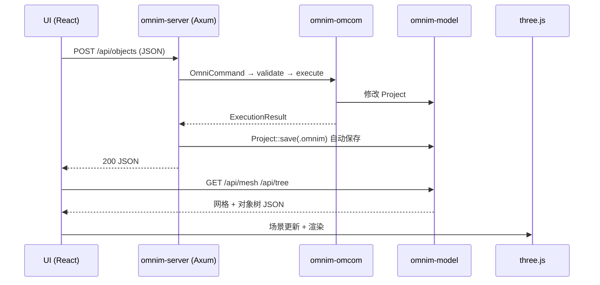
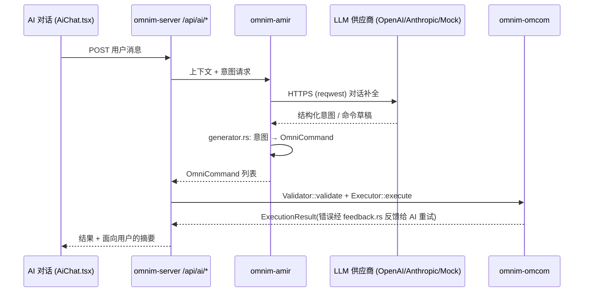
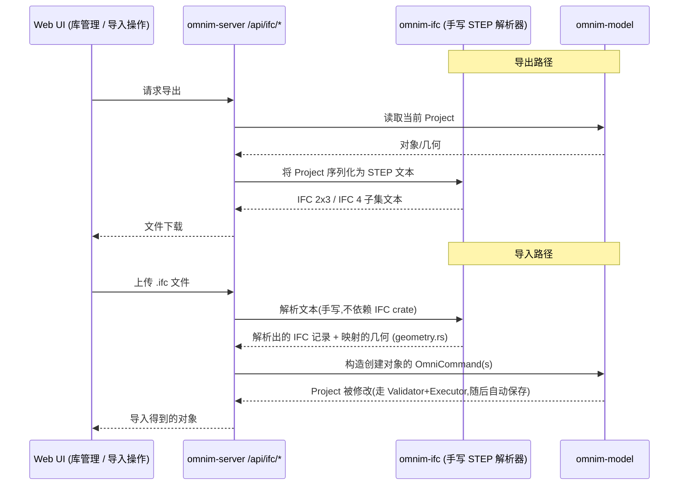
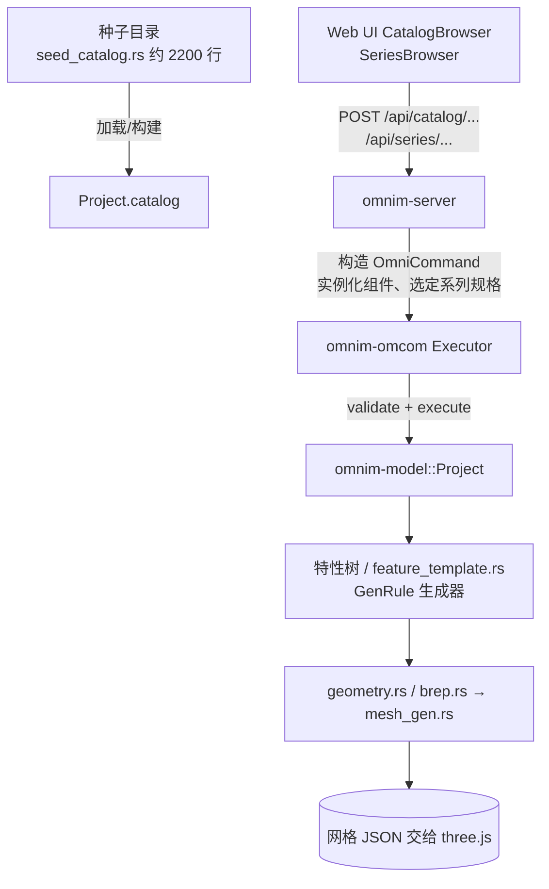
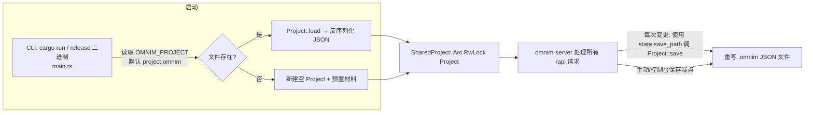

# OmniM — 数据流

本文描述**当前代码中真实存在的端到端数据流**,依据 `crates/server/src/lib.rs`、
`crates/omcom/src/lib.rs`、`crates/amir/src/generator.rs` 与 `crates/ifc/` 编写。
凡仅处于规划中的机制,均会显式标注**规划中**。

架构总览见 [PLATFORM_ARCH.md](PLATFORM_ARCH.zh-CN.md);本页聚焦**数据如何流动**。

---

## 0. 通用变更规则

先讲贯穿所有流程的规则:**对 `Project` 的每一次写入——无论是鼠标点击、AI 回复还是 REST 调用——
都会变成一条 `OmniCommand`**(schema 定义于 `proto/omcom.proto`,类型位于 `omnim-omcom`),然后经过:

```
OmniCommand ──▶ Validator::validate(cmd, &Project)──▶ (收集错误;有错即中止)
            ──▶ Executor::execute(cmd, &mut Project) ─▶ ExecutionResult + 撤销/重做条目
```

这一唯一咽喉点是下文所有图的基础。

---

## 1. (a) 用户点击 → REST → Executor → 模型变更 → 网格 → three.js 渲染

最常见的流程,比如在工具栏点击"创建墙体":

```
┌─ 浏览器 ───────────────────────────────────────────────────────┐
│ React 组件(如 MainToolbar.tsx)                                 │
│   │ 用户点击                                                    │
│   ▼                                                             │
│ 类型化 REST 客户端 (shared/api.ts) → POST /api/objects  (JSON)   │
│   … Zustand store / React Query 使受影响的查询失效               │
└──────────────────────────────┬──────────────────────────────────┘
                               │ HTTP /api/*
┌──────────────────────────────▼──────────────────────────────────┐
│ omnim-server (Axum)                                             │
│   • 处理器获取 project.write() + executor.write()               │
│   • 就地拼装 OmniCommand{ action, operations:[…] }              │
│   • Executor::execute() → 校验 → 修改 Project                   │
│   • Project::save(save_path) — 自动保存 .omnim JSON 文件        │
│   • 返回对象/JSON(或错误状态码)                                 │
└──────────────────────────────┬──────────────────────────────────┘
                               │ 200 OK
       (回到浏览器)             │
                               ▼
      React Query 重新拉取对象树 → 拉取网格
                               │
┌──────────────────────────────▼──────────────────────────────────┐
│ omnim-model                                                      │
│   geometry.rs / brep.rs 用 truck 内核构建实体                     │
│   mesh_gen.rs 剖分 → 三角网格(位置/法线)                         │
└──────────────────────────────┬──────────────────────────────────┘
                               │
┌──────────────────────────────▼──────────────────────────────────┐
│ three.js 渲染器 (web/src/app/components/ThreeViewer.tsx)         │
│   载入网格与对象变换,更新场景图并渲染                             │
└─────────────────────────────────────────────────────────────────┘
```

代码层面的事实:

- **网格是从服务器反复拉取的** —— 几何重建发生在 Rust 侧(`omnim-model` 的 mesh_gen.rs),
  浏览器是纯粹的展示客户端。
- **没有推送通道**:每次变更后 UI 重新拉取状态(调用 resolve 后使相关 query 失效)。
  代码库中不存在 WebSocket。

### Mermaid 版本



---

## 2. (b) 自然语言 → AMIR 引擎(LLM 供应商)→ OmniCommand → Validator → Executor



代码中实际发生的事:

1. **上下文组装**(`amir::context`):对相关 `Project` 状态(选中对象、目录信息、最近历史)
   做快照,让 LLM 的回答言之有据。
2. **供应商抽象**(`amir::lib`):由配置值 `"openai" | "anthropic"` 选择供应商,
   另有 `Mock` 供应商供离线/测试使用。通信就是 `reqwest` 发起的**普通 HTTPS** ——
   没有 SDK,没有本地模型运行时。
3. **意图 → 命令**(`amir/src/generator.rs`):这份大文件用规则 + 模板把意图映射到具体的
   `OmniCommand` 载荷;`prompt_parser.rs` 处理更松散的自由文本,`templates.rs` 存放响应模板,
   `feedback.rs` 把 Executor 的错误转回可重试的 AI 反馈。
4. **同一道门:** 生成的命令**不会**直接写 `Project`,而是和用户点击走同一个 Validator/Executor
   (见 §0)。这是关键的安全属性 —— 幻觉出来的命令会大张旗鼓地失败,而不是悄然腐蚀状态。
5. **反向描述**(`amir::reverse`):引擎也能把已有 `Project` 描述成自然语言
   (属于摘要/文档生成,不是变更)。

> 上节代码中的 `generator.ts` / `lib` 之类的标注指 `amir/src/` 下相应模块;
> 本项目并未使用 LLM SDK,也绝非仅在浏览器里跑模型。

---

## 3. (c) IFC 导入 / 导出



代码事实:

- `omnim-ifc` 包含**手写的解析器与序列化器**(没有使用任何 IFC 生态的 Rust crate —— ADR-0005)。
- 覆盖范围**是局部的** —— 仅覆盖 **IFC 2x3 与 IFC 4** 的一个子集;不支持的实体被跳过,
  而不是整体报错。
- 导入**不会**原生直写 `Project`;而是转换成 `OmniCommand`(或通过同一命令路径触发的
  建模调用),这样导入内容与其他变更一样进入撤销栈。
- `fixtures/ifc/` 下的示例 IFC 文件(`simple.ifc`, `test_building.ifc`, `part.ifc` 等)
  就是用来跑通这条流的。

---

## 4. (d) 目录 / 系列实例化

PARAGON 式**组件目录**与 SPECON 式**系列库**位于 `omnim-model`
(`catalog.rs`, `seed_catalog.rs`, `series_store.rs`, `library.rs`)。



叙述:

1. **目录条目:** 每个目录组件声明一套参数 schema 与默认参数(PARAGON 式参数驱动的零件定义)。
2. **系列:** 一个系列把一个目录组件绑定到一组带尺寸的变体(SPECON 式),用户选择的是
   **系列 + 规格**,而非裸尺寸。
3. **实例化:** 选定后产生一条 *instantiate* `OmniCommand`;执行时在项目树中新增对象,
   参数取自所选系列的记录。
4. **生成:** 新对象的特性树(`GenRule` 生成器,`feature_template.rs`)驱动几何构建
   (`brep.rs`,走 truck 内核)与网格剖分(`mesh_gen.rs`),最终交给 three.js 查看器。

因此从目录选定之后的一切流程都与 §1 相同,只是**起点**不同。

---

## 5. (e) `.omnim` JSON 文件的保存 / 加载



机制细节:

- **一进程一文件。** `omnim_server::ServerConfig { project, save_path, ... }`。
  `OMNIM_PROJECT` 指向可写路径时 `save_path` 为 `Some`;使用默认占位文件时为 `None`
  (此时不自动保存)。
- **整体重写,非增量。** 每次保存把**整个 `Project`** 序列化成 JSON 并重写文件。
  没有日志(journal)、没有 WAL、没有检查点。
- **崩溃窗口:** 若进程在"变更成功"与"成功写盘"之间被杀,文件会落后甚至(理论上)截断;
  目前没有原子重命名的落盘模式。
- **无历史。** 一个文件 = 一份快照。撤销/重做只存在于内存中的 `Executor` 状态里。
- **体量风险:** 面对非常大的项目(大规模的 `seed_catalog` 展开),单体文件的整体
  序列化天然是 O(项目大小)/每次变更。这正是规划中数据库持久化方案要解决的问题
  (见 [PLATFORM_ARCH.zh-CN.md §9](PLATFORM_ARCH.zh-CN.md#9-未来方向尚未实现))。

---

## 6. 不存在的流程

为避免误会,以下有人容易默认存在的路径**并未实现**:

- **没有 WebSocket / SSE / 推送。** 浏览器以 React Query 重新拉取替代。
- **没有 LLM 流式输出。** AMIR 的 LLM 回复是整体接收后做命令校验。
- **没有服务端预览渲染** —— 既没有服务端栅格化图片,也没有服务端 GPU 计时所图。
- **没有多文件工程模型**,也没有按对象的文件持久化。只有一个 `.omnim`。
- **没有工作区/分支**意义上的多版本管理(仓库的 git 分支与产品无关)。
