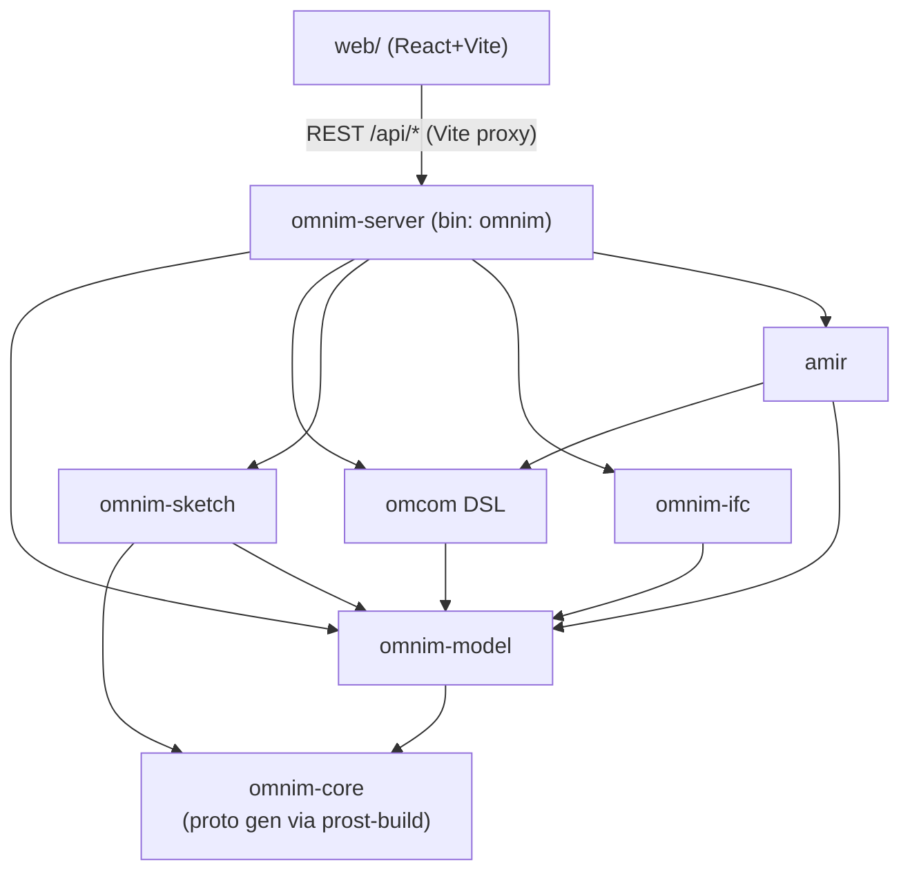

# Architecture Map

[English](ARCHITECTURE_MAP.md) | [简体中文](ARCHITECTURE_MAP.zh-CN.md)

A developer's map of the OmniM workspace: what each crate is responsible for, how they depend on each other, and where to make common kinds of changes.

## Crate Responsibilities

### `crates/core` — `omnim-core`
- The shared foundation: domain primitives and enums (`ObjectType`, lifecycle states, units) re-exported to every other crate.
- **Proto codegen lives here**: `crates/core/build.rs` compiles `proto/omnim.proto` + `proto/omcom.proto` with `prost-build` and derives `serde::Serialize`/`Deserialize` on every generated type, so protocol messages are Rust structs usable both for wire (prost) and JSON (serde). CWD-relative source paths mean builds must run against the checked-out tree (`../../proto/...`).

### `crates/model` — `omnim-model`
- The unified data model — the biggest crate conceptually. Key modules:
  - `store.rs`, `object.rs`, `project.rs` — project/object store, containment graph, persistence.
  - `catalog.rs` + `seed_catalog.rs` — the Component Catalog (元件库): parametric component definitions with params/connectors/feature trees; `seed_catalog.rs` (2.2k LOC) seeds the built-in types. Note there are two related concepts: the catalog (`catalog.rs`) and the sketch-based catalog component pipeline handled through `/api/components`.
  - `library.rs` — the serializable master library (`~/.omnim/library.omnimlib`). Exposed as a global `LIBRARY` static.
  - `breakdown.rs`, `administrative.rs`, `lifecycle.rs`, `material.rs`, `measurement.rs` — engineering context: WBS breakdowns, admin/site/spatial hierarchy, lifecycle records, materials, measurements.
  - `series_store.rs` — Series Library (系列库/等级库) with spec-driven selector trees.
  - `brep.rs`, `geometry.rs`, `mesh_gen.rs`, `feature.rs`, `feature_template.rs`, `gen_rule/`, `profile/` — geometry/feature machinery using `truck-*` kernels.
- Depends on `omnim-core`.

### `crates/sketch` — `omnim-sketch`
- 2D sketching: sketch planes, entities, and a constraint solver (`solver.rs`, wrapping the `slvs` solver, ~700 LOC). Also `profile.rs` for swept profiles.
- This is the front of the sketch → constraint → feature → BRep pipeline used by both part modeling and catalog definitions.

### `crates/omcom` — the Omcom DSL
- `lib.rs` (~3.6k LOC, a single file): the interpreter for the **Omcom** text command language. Every mutation path — console input, REST `/api/omcom`, AI-generated commands — funnels into `omnim_omcom::execute` style entry points which mutate the project and library. This is the "one command language" at the heart of README's design.

### `crates/server` — `omnim-server`
- `lib.rs` (~3.6k LOC): all Axum routes and handlers. REST surface spans objects/properties/materials/measurements/lifecycle/administrative/breakdown/omcom/mesh/sketches/components/catalog/series/AMIR/undo-redo/IFC import-export — about 120 routes under `/api/*`.
- `main.rs`: the `omnim` binary — env resolution (`OMNIM_PROJECT`/`OMNIM_HOST`/`OMNIM_PORT`), library init, shared `Arc<RwLock<Project>>`.
- Depends on model, omcom, sketch, ifc, amir, core.

### `crates/ifc` — `omnim-ifc`
- `lib.rs` + `geometry.rs`: STEP/IFC text parsing & writing, and geometric interpretation. Exposed to the server as `/api/import/ifc` and `/api/export/ifc`.

*(Removed 2026-10-27: the orphan `omnim-renderer` wgpu demo crate was deleted from the workspace; rendering is three.js in the browser. A native viewer would be re-introduced via an RFC.)*

### `crates/amir` — AMIR
- AI ↔ model bridge. `lib.rs` defines `AmirOrient`-style orchestration + `AmirConfig`/`from_env`; `intent.rs` and `prompt_parser.rs` turn natural language into Omcom commands; `reverse.rs` describes model → language; `feedback.rs` translates errors.
- LLM providers in `llm/`: `mock.rs`, `openai.rs`, `anthropic.rs` behind a `Provider` trait. `AMIR_PROVIDER=mock` is keyless and links intent → Omcom deterministically.

### `web/` — frontend
- React 19 + Vite + three.js + zustand + react-query + react-router.
- `web/src/app/` — application shell: `App.tsx`, `panels/` (panel registry + object tree/properties/domains panels), `components/` (ThreeViewer, ObjectTree, OmcomConsole, AiChat, CatalogBrowser, SeriesBrowser, …), `store/`, `layout/`, `context/`.
- `web/src/shared/` — `api.ts` (typed REST client), `types.ts`, `queries.ts`, geometry helpers.
- `web/src/sketch/`, `web/src/library/`, `web/src/series/` — catalog component editor, library manager page, series manager page.
- Unit tests in `web/src/__tests__/` (Vitest).

## Dependency Graph

(Crates also share `serde_json`/`glam`/`uuid` via `[workspace.dependencies]`.)

## Where to Find Things — Common Change Recipes

**Adding a new OmniCommand / Omcom operation**
1. `proto/omcom.proto` — extend `Operation` / add fields (also `proto/omnim.proto` for model-side types).
2. `crates/core/build.rs` — no change usually; codegen picks up the proto automatically. Serde derives are already applied to all generated types.
3. `crates/omcom/src/lib.rs` — implement the parse + execute branch for the new op.
4. `web/src/shared/api.ts` and the Omcom console UI in `web/src/app/components/OmcomConsole.tsx` to surface it.

**Adding a REST route**
1. Add handler + `.route("/api/…", get/post/put/delete(...))` in `crates/server/src/lib.rs` (all routes registered in one `Router` chain).
2. Add a typed client method in `web/src/shared/api.ts` and, where applicable, a react-query wrapper in `web/src/shared/queries.ts`.
3. Add test coverage in `crates/server/tests/api_integration.rs`.

**Adding a new component-catalog type**
1. `crates/model/src/seed_catalog.rs` — add the seeded definition (params, connectors, template).
2. `crates/model/src/catalog.rs` — types/logic if the data model needs new fields.
3. If such a type appears in the browser UI, check `web/src/app/components/CatalogBrowser.tsx` mappings.

**Adding a new UI panel**
1. Define the panel in `web/src/app/panels/PanelTypes.ts` and register it in `web/src/app/panels/PanelRegistry.tsx` / `defaultPanels.ts`.
2. Implement content in `web/src/app/components/` (or DomainPanels inside `panels/DomainPanels.tsx`).
3. Wired data flows through `web/src/shared/api.ts`.

**Adding a new sketch constraint or entity**
- `crates/sketch/src/lib.rs` (types) and `crates/sketch/src/solver.rs` (mapping to `slvs`), then wire REST handlers in `crates/server/src/lib.rs` (`/api/sketches/...`) and the sketch editor in `web/src/sketch/`.

**Proto/serde coding conventions**
- All generated proto types get `#[derive(serde::Serialize, serde::Deserialize)]` — see the single `type_attribute` call in `crates/core/build.rs`. Don't hand-maintain JSON DTOs for protocol messages.
- Workspace edition is **2021** (`Cargo.toml`), shared deps centrally in `[workspace.dependencies]` — use `workspace = true` inheritance when adding a dependency to a crate.
- More depth in `docs/architecture/PLATFORM_ARCH.md`.
