# 架构地图

[English](ARCHITECTURE_MAP.md) | [简体中文](ARCHITECTURE_MAP.zh-CN.md)

OmniM 工作区的开发者地图：各 crate 的职责、彼此依赖，以及常见改动要去哪里做。

## 各 Crate 职责

### `crates/core` — omnim-core
- 共享基础：领域原语与枚举（`ObjectType`、生命周期状态、单位），导出给其它所有 crate。
- **proto 代码生成也在这里**：`crates/core/build.rs` 用 `prost-build` 编译 `proto/omnim.proto` + `proto/omcom.proto`，并为每个生成类型派生 `serde::Serialize`/`Deserialize`，因此协议消息既是 Rust 结构体，既可走线路（prost）也可走 JSON（serde）。生成脚本使用相对路径 `../../proto/...`，构建必须在检出的目录树上运行。

### `crates/model` — omnim-model
- 统一数据模型，概念上是最大的 crate。重要模块：
  - `store.rs`、`object.rs`、`project.rs` — 项目/对象存储、包含关系图、持久化。
  - `catalog.rs` + `seed_catalog.rs` — 元件库（Component Catalog）：带参数/连接件/特征树的参数化组件定义；`seed_catalog.rs`（约 2.2k 行）负责内置类型的种子数据。注意有两个相关但不同的概念：目录（`catalog.rs`）与基于草图的目录组件管线（走 `/api/components`）。
  - `library.rs` — 可序列化的主库（`~/.omnim/library.omnimlib`），以全局静态 `LIBRARY` 暴露。
  - `breakdown.rs`、`administrative.rs`、`lifecycle.rs`、`material.rs`、`measurement.rs` — 工程上下文：WBS 分解、管理/场地/空间层级、生命周期记录、材料、测量。
  - `series_store.rs` — 系列库（等级库），带规格驱动的选择器树。
  - `brep.rs`、`geometry.rs`、`mesh_gen.rs`、`feature.rs`、`feature_template.rs`、`gen_rule/`、`profile/` — 基于 truck-* 内核的几何/特征机制。
- 依赖 omnim-core。

### `crates/sketch` — omnim-sketch
- 2D 草图：草图平面、实体与约束求解器（`solver.rs`，包装 `slvs` 求解器，约 700 行）。另有 `profile.rs` 处理扫掠轮廓。
- 它是 草图 → 约束 → 特征 → BRep 管线的入口，零件建模与目录定义共用此管线。

### `crates/omcom` — Omcom DSL
- `lib.rs`（约 3.6k 行，单文件）：**Omcom** 文本命令语言的解释器。所有变更路径——控制台输入、REST `/api/omcom`、AI 生成的指令——都汇聚到 `omnim_omcom` 的 execute 入口，由它变更项目与库。这就是 README 所说"一条命令语言"的核心。

### `crates/server` — omnim-server
- `lib.rs`（约 3.6k 行）：全部 Axum 路由与处理函数。REST 面覆盖 对象/属性/材料/测量/生命周期/管理/分解/omcom/网格/草图/组件/目录/系列/AMIR/撤销重做/IFC 导入导出——`/api/*` 下约 120 条路由。
- `main.rs`：`omnim` 二进制——读取环境变量（`OMNIM_PROJECT`/`OMNIM_HOST`/`OMNIM_PORT`）、初始化元件库、创建共享的 `Arc<RwLock<Project>>`。
- 依赖 model、omcom、sketch、ifc、amir、core。

### `crates/ifc` — omnim-ifc
- `lib.rs` + `geometry.rs`：STEP/IFC 文本解析与写出，及几何解释。对服务器暴露为 `/api/import/ifc` 与 `/api/export/ifc`。

*(2026-10-27 起已删除：孤立的 `omnim-renderer` wgpu 演示 crate 已从 workspace 移除；渲染由浏览器内 three.js 承担。原生查看器方案如需重启将以 RFC 形式立项。)*

- 小型 wgpu 辅助 crate：`mesh.rs`、`camera.rs`、`shader.wgsl`。目前主要作为参考类型供 Web three.js 视图使用；UI 的 3D 运行时是浏览器里的 three.js。

### `crates/amir` — AMIR
- AI 与模型之间的桥。`lib.rs` 定义编排逻辑 + `AmirConfig`/`from_env`；`intent.rs` 与 `prompt_parser.rs` 把自然语言转成 Omcom 命令；`reverse.rs` 做模型 → 语言描述；`feedback.rs` 翻译错误。
- `llm/` 下的 LLM 供应商：`mock.rs`、`openai.rs`、`anthropic.rs`，由 `Provider` trait 统一。`AMIR_PROVIDER=mock` 免密钥，且将意图确定性映射到 Omcom。

### `web/` — 前端
- React 19 + Vite + three.js + zustand + react-query + react-router。
- `web/src/app/` — 应用外壳：`App.tsx`、`panels/`（面板注册表 + 对象树/属性/领域面板）、`components/`（ThreeViewer、ObjectTree、OmcomConsole、AiChat、CatalogBrowser、SeriesBrowser 等）、`store/`、`layout/`、`context/`。
- `web/src/shared/` — `api.ts`（带类型的 REST 客户端）、`types.ts`、`queries.ts`、几何辅助。
- `web/src/sketch/`、`web/src/library/`、`web/src/series/` — 目录组件编辑器、库管理页、系列管理页。
- 单元测试在 `web/src/__tests__/`（Vitest）。

## 依赖关系图

```mermaid
graph TD
    core["omnim-core<br/>（prost-build 生成 proto）"]
    model["omnim-model"]
    sketch["omnim-sketch"]
    omcom["omcom DSL"]
    ifc["omnim-ifc"]
    amir["amir"]
    server["omnim-server（二进制 omnim）"]
    web["web/（React+Vite）"]

    model --> core
    sketch --> core
    sketch --> model
    omcom --> model
    ifc --> model
    amir --> omcom
    amir --> model
    server --> model
    server --> omcom
    server --> sketch
    server --> ifc
    server --> amir
    web -- "REST /api/*（Vite 代理）" --> server
```

（各 crate 通过 `[workspace.dependencies]` 共享 `serde_json`/`glam`/`uuid`。）

## 常见改动去哪里做

**新增 OmniCommand / Omcom 操作**
1. `proto/omcom.proto` — 扩展 `Operation` / 增加字段（模型侧类型在 `proto/omnim.proto`）。
2. `crates/core/build.rs` — 通常无需修改；代码生成会自动拾取 proto。serde 派生已应用于所有生成类型。
3. `crates/omcom/src/lib.rs` — 为新操作实现解析与执行分支。
4. `web/src/shared/api.ts` 与 Omcom 控制台 UI（`web/src/app/components/OmcomConsole.tsx`）将其暴露出来。

**新增 REST 路由**
1. 在 `crates/server/src/lib.rs` 添加处理函数与 `.route("/api/…", get/post/put/delete(...))`（所有路由在一条 `Router` 链上注册）。
2. 在 `web/src/shared/api.ts` 添加带类型的客户端方法，必要时在 `web/src/shared/queries.ts` 包一层 react-query。
3. 在 `crates/server/tests/api_integration.rs` 补充测试。

**新增元件目录类型**
1. `crates/model/src/seed_catalog.rs` — 添加种子定义（参数、连接件、模板）。
2. `crates/model/src/catalog.rs` — 若数据模型需要新字段则在此扩展类型/逻辑。
3. 若该类型要在浏览器 UI 出现，检查 `web/src/app/components/CatalogBrowser.tsx` 的映射。

**新增 UI 面板**
1. 在 `web/src/app/panels/PanelTypes.ts` 定义面板，并在 `web/src/app/panels/PanelRegistry.tsx` / `defaultPanels.ts` 注册。
2. 在 `web/src/app/components/` 实现内容（或在 `panels/DomainPanels.tsx` 里）。
3. 数据通过 `web/src/shared/api.ts` 接入。

**新增草图约束或实体**
- `crates/sketch/src/lib.rs`（类型）与 `crates/sketch/src/solver.rs`（映射到 `slvs`），然后在 `crates/server/src/lib.rs` 接 REST 处理（`/api/sketches/...`），编辑器在 `web/src/sketch/`。

**proto/serde 编码约定**
- 所有生成的 proto 类型都带 `#[derive(serde::Serialize, serde::Deserialize)]`——见 `crates/core/build.rs` 里那一句 `type_attribute`。不要为协议消息手写 JSON DTO。
- 工作区 edition 是 **2021**（`Cargo.toml`），共享依赖集中在 `[workspace.dependencies]`——给 crate 加依赖时使用 `workspace = true` 继承。
- 更深入的架构见 `docs/architecture/PLATFORM_ARCH.md`。
